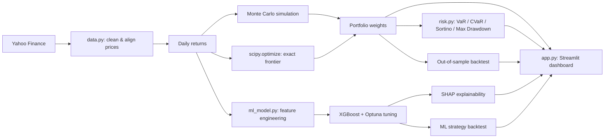

# Investment Portfolio

[](https://github.com/WObszan/Investment_Portfolio/stargazers)
[](https://www.python.org/)
[](https://investmentportfolio-wo.streamlit.app)
[](https://github.com/WObszan/Investment_Portfolio/actions/workflows/tests.yml)

Portfolio construction, risk analysis, and price-direction forecasting for equity portfolios.

**🔗 Live demo:** https://investmentportfolio-wo.streamlit.app

## Project goal

Investment Wallet turns raw price data into an optimized, risk-audited portfolio in one
pipeline. It combines classical Modern Portfolio Theory (Monte Carlo + exact `scipy`
optimization) with a supervised ML model (XGBoost + SHAP) that predicts short-term price
direction — both evaluated strictly out-of-sample.

## Architecture



## Setup

```bash
cd portfolio-dashboard
uv venv && uv pip install -r requirements.txt
```

> All dependencies are pinned to the versions the tests and app were checked with (Python 3.12).
> `pandas-ta` is pinned to a pre-release (`0.4.71b0`) — if the install fails, this is the package to check first.

## Common commands

```bash
streamlit run app.py
pytest -v
```

## What it does

- **Data** — downloads multi-ticker price history (`yfinance`) in one request, drops
  tickers that return no data, forward-fills isolated gaps after listing, and computes
  returns over the **common period** where every selected ticker has prices (see
  Limitations). Indices such as `^GSPC` are used as benchmarks only and are excluded from
  optimization and the backtest.
- **Portfolio optimization** — Monte Carlo simulation (10k+ portfolios) *and* an exact
  efficient frontier via `scipy.optimize` (SLSQP), including dedicated Max Sharpe / Min
  Variance solvers. All of them share one `max_weight` bound; frontier points that do not
  converge are flagged and not plotted.
- **Risk metrics** — VaR, CVaR, Sortino Ratio, Max Drawdown, CAGR and Calmar Ratio
  (CAGR / |Max Drawdown|), computed for the exact scipy weights and labelled in-sample.
- **Market risk** — CAPM regression (alpha/beta) and rolling beta over time.
- **Clustering** — K-Means grouping of assets by risk/return profile.
- **Backtesting** — chronological, non-overlapping train/test split; Max Sharpe weights are
  frozen on training data (risk-free rate = average ^IRX over the train window) and evaluated
  on unseen data (average ^IRX over the test window) against an equal-weight portfolio and a
  benchmark. The table reports both the arithmetic annual mean (used for Sharpe) and CAGR;
  the chart shows daily-rebalanced and buy-and-hold (weights drift) versions.
- **DCA projection** — median and 16th–84th percentile range of 5,000 Monte Carlo paths
  (normal monthly returns, fixed seed) under periodic contributions, plus the deterministic
  mean path, with capped return assumptions to avoid extrapolating short-term rallies.
- **ML price-direction model** — XGBoost classifier on stationary technical features (RSI,
  MACD, volatility, relative strength vs. benchmark, volume ratio, 20-day OBV change), tuned
  with Optuna on a held-out validation split with a 5-row purge gap between train, validation
  and test, explained with SHAP, and backtested on a forward-return basis with 5 bps per
  position change. Accuracy is reported against naive baselines ("always up" and the training
  majority class), and a 5-fold expanding-window walk-forward reports mean ± std across folds.


## Continuous Integration (CI)

This repository includes an automated GitHub Actions workflow (.github/workflows/tests.yml). On every push or pull_request to the main branch, the pipeline automatically:
- Sets up a clean Python 3.12 environment on ubuntu-latest.
- Installs uv and project dependencies.
- Executes the full test suite via pytest.

## Key results

Run configuration (re-run on 2026-11-12 after the audit fixes):
- tickers `AAPL (Apple Inc.), BA (Boeing Company), BLK (BlackRock Inc.), GOOGL (Alphabet Inc.), ^GSPC (S&P 500 Index), JPM (JPMorgan Chase & Co.), PLTR (Palantir Technologies),
TMO (Thermo Fisher Scientific), UPS (United Parcel Service)`; `^GSPC` is the benchmark and is not part of the portfolio,
- data requested from 2015-01-01, but PLTR listed on 2020-09-30, so the **effective common period is
  2020-10-01 – 2026-11-11 (1,536 trading days)**,
- 75/25 train/test split, `max_weight` = 1.0, risk-free rate = average ^IRX over each window
  (3.15% full period, 2.93% train, 3.83% test).

**Portfolio optimization (exact scipy, in-sample)**
- Max Sharpe portfolio: 35.10% annual return (arithmetic), 25.20% annual risk, Sharpe ratio 1.27
  (weights: JPM 52%, GOOGL 21%, PLTR 19%, AAPL 8%).
- Min Variance portfolio: 18.53% annual risk, 17.96% annual return.
- Monte Carlo check (10,000 random portfolios): best sampled Sharpe 1.20 and lowest sampled risk
  18.85%, both slightly worse than the exact solutions, as expected. All 100 frontier points
  converged, and the Max Sharpe portfolio lies on the frontier (25.21% vs 25.20% risk).

**Risk (in-sample, exact weights, 95% confidence)**
- Max Sharpe portfolio: daily VaR 2.35%, CVaR 3.27%, Max Drawdown -41.43%, CAGR 37.61%.
- Min Variance portfolio: daily VaR 1.77%, CVaR 2.57%, Max Drawdown -27.69% — 13.7 percentage points
  shallower than Max Sharpe, at the cost of a lower Sortino (1.18 vs 1.98) and Calmar ratio (0.64 vs 0.91).

**Out-of-sample backtest** (train 2020-10-01 – 2025-05-05, test 2025-05-06 – 2026-11-11, 383 days)
| Strategy | Annual Return (arithmetic) | CAGR (geometric) | Annual Risk | Sharpe | Max Drawdown |
|---|---|---|---|---|---|
| Max Sharpe (train weights, daily-rebalanced) | 29.91% | 31.09% | 23.85% | 1.09 | -17.54% |
| Equal Weight (daily-rebalanced) | 29.38% | 32.08% | 17.60% | 1.45 | -15.84% |
| Benchmark (^GSPC) | 20.52% | 21.74% | 12.98% | 1.29 | -9.10% |

The optimized portfolio (63% JPM, 29% PLTR, 8% GOOGL from the training window) earned more than
the S&P 500 but with lower risk-adjusted return (Sharpe 1.09 vs 1.29), and it underperformed the
naive equal-weight portfolio on CAGR, risk and Sharpe. This is a well-documented effect
(the "1/N puzzle", DeMiguel et al. 2009): Sharpe-optimized weights can overfit to in-sample
history, while equal weighting is a surprisingly hard baseline to beat out-of-sample. The test
window is short (about 1.5 years), so these numbers are noisy.

**Diversification** (common period)
- Lowest correlation pairs: BA vs TMO (0.16) and PLTR vs UPS (0.18).

**Market risk (CAPM)** (AAPL vs ^GSPC over their full overlap since 2015)
- AAPL: beta 1.178 (moderately more volatile than the market); daily alpha (0.00047) is too close
  to zero to be a reliable signal of outperformance.

**ML price-direction model** (AAPL, 5-day horizon, full AAPL history since 2015; test 2024-08-26 – 2026-11-04)
- Test accuracy 55.54% vs 56.08% for the "always up" baseline (the training majority class is also
  "up"): **-0.54 percentage points, i.e. no edge**. A 50% coin flip is the wrong baseline because
  AAPL rose in most 5-day windows.
- ML strategy vs Buy & Hold over the test period (5 bps per position change): 26.42% vs 55.13%.
- Walk-forward (5 expanding folds, 2017–2026, fixed parameters): accuracy 52.37% ± 1.60% vs
  "always up" 58.21% ± 4.97% (edge -5.83 ± 5.07 pp); strategy return per fold 30.04% ± 24.97% vs
  buy & hold 63.41% ± 64.94%. The strategy beat buy & hold in 0 of 5 folds.
- The single-split accuracy is sensitive to tiny differences between Yahoo Finance downloads
  (adjusted prices differ by ~1e-4 between requests, which changes the Optuna-selected
  parameters): repeated runs gave 55.5%–56.3%, against the same 56.1% baseline.
- Conclusion: there is no evidence that the technical features predict 5-day direction better than
  the base rate. For reference, the same pipeline on simulated random walks matches the "always up"
  baseline within a few percentage points (see `tests/test_ml.py`).

## Project structure

```
portfolio-dashboard/
├── app.py            # Streamlit UI - no calculation logic
├── data.py            # data download, cleaning, train/test split
├── optimization.py    # Monte Carlo, scipy optimizer, DCA projection
├── risk.py             # VaR/CVaR, Sortino, Max Drawdown, CAPM, rolling beta
├── clustering.py       # K-Means asset grouping
├── ml_model.py         # feature engineering, XGBoost + Optuna + SHAP, ML backtest
├── callbacks.py        # ticker selection widget synchronization
├── viz.py              # Plotly chart builders
├── tests/               # pytest unit tests + offline end-to-end app smoke test
└── requirements.txt
```

## Limitations

- Portfolio backtests assume no transaction costs, taxes, or slippage, and table metrics
  assume daily rebalancing to the target weights. The ML backtest charges 5 bps per position
  change (configurable) but ignores taxes and slippage.
- No short selling; weights are bounded to `[0, max_weight]` (default 1.0, set in the
  Optimization tab). The same bound is used by Monte Carlo, the exact frontier, the exact
  Max Sharpe / Min Variance solvers and the backtest.
- Out-of-sample results depend on the chosen train/test split date and are not
  guaranteed to hold on future data.
- The ML model predicts direction only, over a fixed 5-day horizon — not calibrated
  position sizing or risk-adjusted signal strength. Judge it against the "always up" /
  majority-class baselines and the walk-forward spread, not against 50%. Walk-forward folds use
  fixed (untuned) XGBoost parameters so that no fold is tuned on its own test data.
- The DCA projection assumes normally distributed, independent monthly returns with the
  portfolio's historical mean and volatility; the 16th–84th percentile band is a model range,
  not a forecast, and fat tails or regime changes are not modelled.
- In-sample risk metrics in the Optimization tab are measured on the same data the weights
  were optimized on and overstate what to expect out-of-sample.
- Currency risk is not modeled for non-USD assets.
- **Data window:** daily returns use only the common period in which every selected ticker
  has prices (rows before the latest listing date are dropped, not filled with 0%). Adding a
  recently listed stock therefore shortens the history used for covariance, optimization and
  the backtest; the EDA tab shows the effective start date. Isolated gaps after listing are
  forward-filled on prices.
